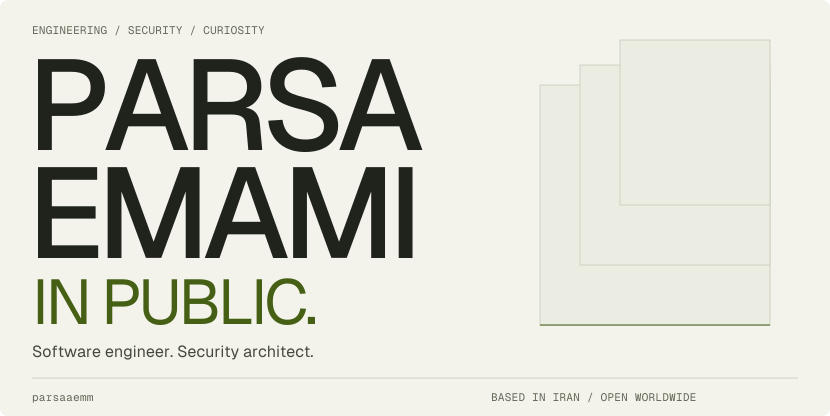
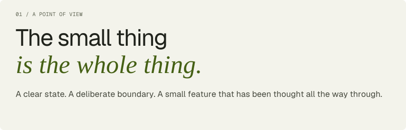
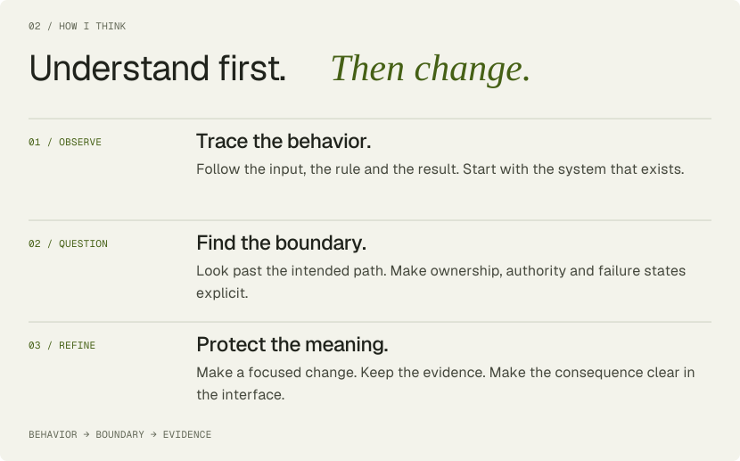
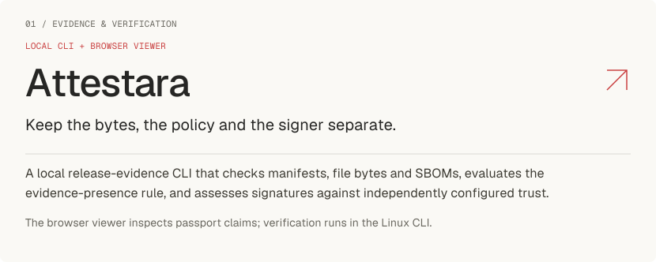
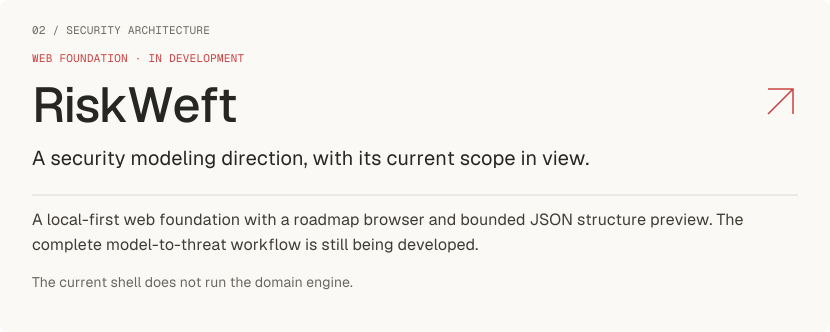
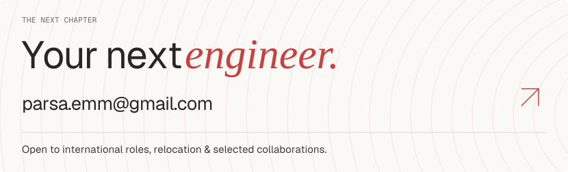
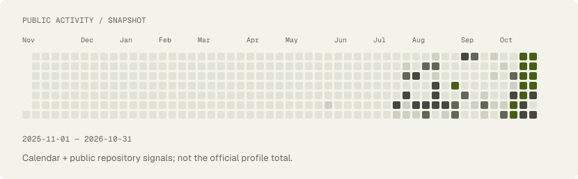

<a href="https://parsaaemm.dev/">
<picture>
  <source media="(max-width: 640px) and (prefers-color-scheme: dark)" srcset="assets/cards/hero-mobile-dark.svg">
  <source media="(max-width: 640px)" srcset="assets/cards/hero-mobile-light.svg">
  <source media="(prefers-color-scheme: dark)" srcset="assets/cards/hero-dark.svg">
  <source media="(prefers-color-scheme: light)" srcset="assets/cards/hero-light.svg">
  
</picture>
</a>

# Parsa Emami

**Software Engineer · Security Architect · Red team perspective**

I build considered software. Then question the assumptions holding it together.

Based in Babol, Iran. Open to international roles, relocation & selected collaborations.

[Website](https://parsaaemm.dev/) · [Selected work](https://parsaaemm.dev/projects/) · [Notes](https://parsaaemm.dev/writing/) · [Résumé](https://parsaaemm.dev/resume/) · [LinkedIn](https://www.linkedin.com/in/parsaaemm/) · [Email](mailto:parsa.emm@gmail.com)

## 01 / A point of view

<a href="https://parsaaemm.dev/#perspective">
<picture>
  <source media="(max-width: 640px) and (prefers-color-scheme: dark)" srcset="assets/cards/perspective-mobile-dark.svg">
  <source media="(max-width: 640px)" srcset="assets/cards/perspective-mobile-light.svg">
  <source media="(prefers-color-scheme: dark)" srcset="assets/cards/perspective-dark.svg">
  <source media="(prefers-color-scheme: light)" srcset="assets/cards/perspective-light.svg">
  
</picture>
</a>

That is where I like to work: connecting the architecture of a system to the experience of using it.

## 02 / How I think

<a href="https://parsaaemm.dev/#method">
<picture>
  <source media="(max-width: 640px) and (prefers-color-scheme: dark)" srcset="assets/cards/principles-mobile-dark.svg">
  <source media="(max-width: 640px)" srcset="assets/cards/principles-mobile-light.svg">
  <source media="(prefers-color-scheme: dark)" srcset="assets/cards/principles-dark.svg">
  <source media="(prefers-color-scheme: light)" srcset="assets/cards/principles-light.svg">
  
</picture>
</a>

> Leaving it alone is better than changing it incorrectly.

## 03 / Work in public

Personal projects. Inspectable code. Honest status.

<a href="https://github.com/Parsa-Emami/Attestara">
<picture>
  <source media="(max-width: 640px) and (prefers-color-scheme: dark)" srcset="assets/cards/project-attestara-mobile-dark.svg">
  <source media="(max-width: 640px)" srcset="assets/cards/project-attestara-mobile-light.svg">
  <source media="(prefers-color-scheme: dark)" srcset="assets/cards/project-attestara-dark.svg">
  <source media="(prefers-color-scheme: light)" srcset="assets/cards/project-attestara-light.svg">
  
</picture>
</a>

**[Attestara — source](https://github.com/Parsa-Emami/Attestara)** · [Project notes](https://parsaaemm.dev/projects/attestara/) · [Passport viewer](https://parsa-emami.github.io/Attestara/#passport)

<a href="https://github.com/Parsa-Emami/Riskweft">
<picture>
  <source media="(max-width: 640px) and (prefers-color-scheme: dark)" srcset="assets/cards/project-riskweft-mobile-dark.svg">
  <source media="(max-width: 640px)" srcset="assets/cards/project-riskweft-mobile-light.svg">
  <source media="(prefers-color-scheme: dark)" srcset="assets/cards/project-riskweft-dark.svg">
  <source media="(prefers-color-scheme: light)" srcset="assets/cards/project-riskweft-light.svg">
  
</picture>
</a>

**[RiskWeft — source](https://github.com/Parsa-Emami/Riskweft)** · [Project notes](https://parsaaemm.dev/projects/riskweft/)

Other explorations: [Demian](https://github.com/Parsa-Emami/Demian) · [Hanna Music Player](https://github.com/Parsa-Emami/Hanna-Music-Player).

I also develop organizational software. Product details, interfaces, source and internal architecture remain confidential. [Professional experience](https://parsaaemm.dev/resume/).

## 04 / A small experiment

**[One byte. Three different questions.](https://parsaaemm.dev/#evidence)**

Change the sample, inspect its SHA-256 digest, sign it and choose whether to trust the demo key. Byte integrity, signature validity and key trust stay separate.

A standalone portfolio experiment; not the Attestara runtime.

## 05 / The person behind the handle

Red teaming taught me to look beyond the intended path. Software engineering taught me that the response has to work for the application and the person using it.

I care about architecture, system design and the visual structure of software. I’m also studying Artificial Intelligence at master’s level.

| Application engineering | Security | Product craft |
| --- | --- | --- |
| PHP / Laravel | Security architecture | Responsive / RTL interfaces |
| JavaScript / TypeScript | Threat modeling | Interaction states |
| Application architecture | Red team perspective | System design |
| Regression protection | Authorization boundaries | Information hierarchy |

## 06 / Field notes

- [An agent needs a boundary.](https://parsaaemm.dev/writing/ai-security-architecture/) — Security architecture
- [Context is part of the contract.](https://parsaaemm.dev/writing/laravel-tenant-isolation/) — Application architecture
- [Understand before replacing.](https://parsaaemm.dev/writing/refactoring-legacy-laravel-safely/) — Engineering practice

<a href="mailto:parsa.emm@gmail.com">
<picture>
  <source media="(max-width: 640px) and (prefers-color-scheme: dark)" srcset="assets/cards/footer-mobile-dark.svg">
  <source media="(max-width: 640px)" srcset="assets/cards/footer-mobile-light.svg">
  <source media="(prefers-color-scheme: dark)" srcset="assets/cards/footer-dark.svg">
  <source media="(prefers-color-scheme: light)" srcset="assets/cards/footer-light.svg">
  
</picture>
</a>

[Let’s talk](mailto:parsa.emm@gmail.com) · [Read my résumé](https://parsaaemm.dev/resume/) · [Explore the portfolio](https://parsaaemm.dev/)

Activity snapshot

<picture>
  <source media="(prefers-color-scheme: dark)" srcset="assets/cards/contributions-dark.svg">
  <source media="(prefers-color-scheme: light)" srcset="assets/cards/contributions-light.svg">
  
</picture>

Period: 2025-10-26 — 2026-10-25. Calendar and public repository commit signals are merged per day. This is an activity snapshot, not the official GitHub profile contribution total.

