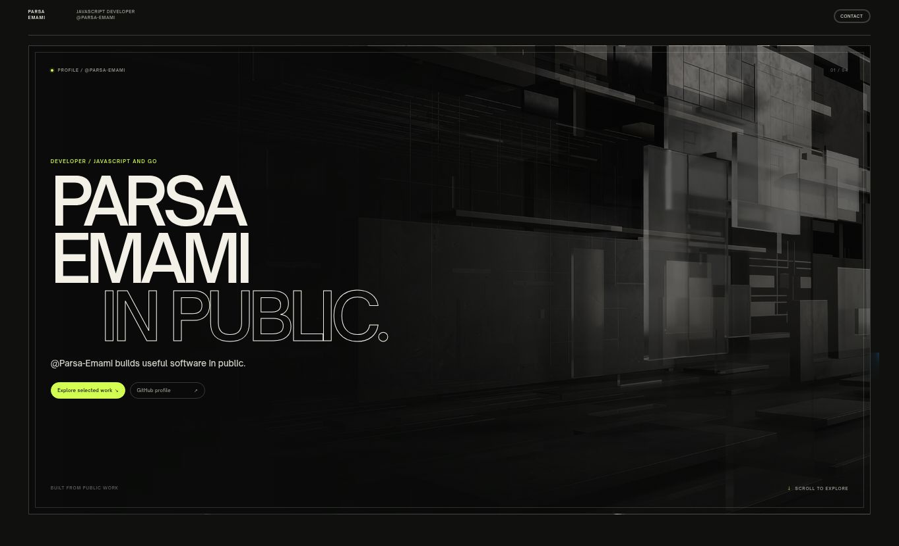
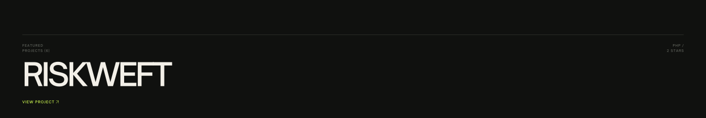
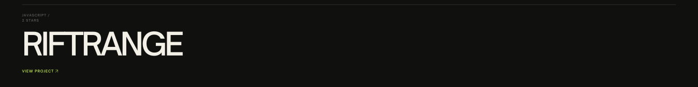
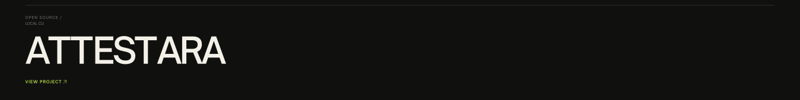
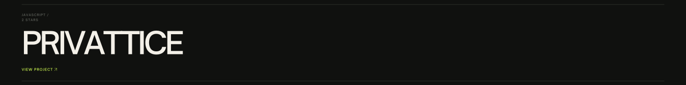
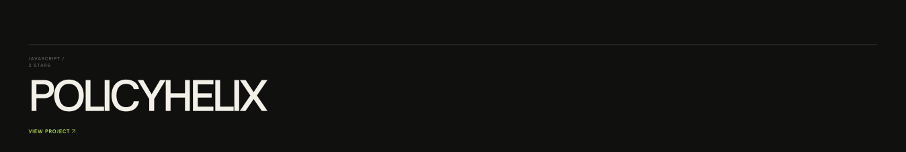
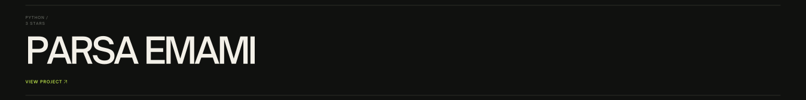
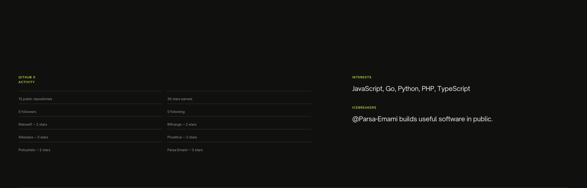
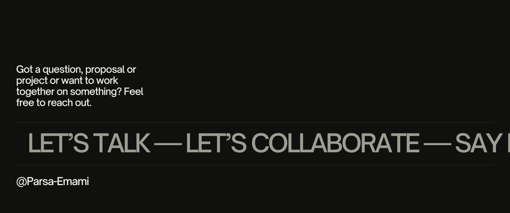
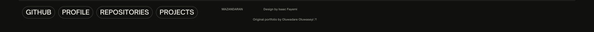

# Parsa Emami · پارسا امامی

**Software Engineer · Security Architect**

I build Laravel backend systems and local-first open-source security tools. My work emphasizes verifiable releases, authorization boundaries and reproducible engineering.

[Official website — Parsa Emami](https://parsaaemm.dev/) · [LinkedIn — Parsa Emami](https://www.linkedin.com/in/parsaaemm/) · [GitHub — Parsa-Emami](https://github.com/Parsa-Emami) · [Résumé](https://parsaaemm.dev/resume/) · [Email](mailto:parsa.emm@gmail.com)

Based in Babol, Iran. Open to English-speaking software and application-security roles, with the Netherlands as a preferred relocation destination; remote, hybrid and on-site considered.

## Selected engineering work

- **[Attestara](https://github.com/Parsa-Emami/Attestara)** — *Local CLI + browser viewer*. A local release-evidence CLI that checks manifests, file bytes and SBOMs, evaluates the evidence-presence rule, and assesses signatures against independently configured trust. [Technical evidence](https://parsaaemm.dev/projects/attestara/)
- **[KeyHelix](https://github.com/Parsa-Emami/Keyhelix)** — *Local-first workspace · Linux v1 release*. Offline-first secrets and authorization workspace with scoped access, audited reveals and key rotation. The published release targets Linux x86_64. [Technical evidence](https://github.com/Parsa-Emami/Keyhelix/blob/main/docs/release/USER_GUIDE.md)
- **[MirageMesh](https://github.com/Parsa-Emami/Miragemesh)** — *Local workflow · v1 gate pending*. A local-first security application with a supervised Go engine, isolated decoys, durable offline event spooling and a browser interface for incident replay and triage. [Technical evidence](https://github.com/Parsa-Emami/Miragemesh#full-product-endpoint)
- **[BreachAtlas](https://github.com/Parsa-Emami/Breachatlas)** — *Local DFIR workspace · independent offline verifier*. Seals evidence with SHA-256, records custody, builds timelines and exports portable bundles for independent offline verification. [Technical evidence](https://github.com/Parsa-Emami/Breachatlas/blob/main/docs/release/USER_GUIDE.md)
- **[Demian](https://github.com/Parsa-Emami/Demian)** — *Seven single-player games · production acceptance pending*. A café-themed 2D game suite with asynchronous weekly competition and a Laravel backend. Mobile, hosting and character-art acceptance remain separate gates. [Technical evidence](https://github.com/Parsa-Emami/Demian/blob/main/README.fa.md)
- **[RiskWeft](https://github.com/Parsa-Emami/Riskweft)** — *Web foundation · in development*. A local-first web foundation with a roadmap browser and bounded JSON structure preview. The complete model-to-threat workflow is still being developed. [Technical evidence](https://parsaaemm.dev/projects/riskweft/)

### Engineering focus

- **Backend & full-stack:** Laravel/PHP, Go and JavaScript; APIs, testing and maintainable delivery.
- **Security engineering:** authorization boundaries, secret lifecycle, incident evidence and supply-chain verification.
- **Evidence first:** documented scope, reproducible checks and clearly identified release limits.

<a href="https://parsaaemm.dev/"><picture><source media="(max-width: 640px)" srcset="assets/seyi-editorial/hero-mobile.svg"></picture></a>

Archived editorial artwork (2026-10-29) & design credits

<a href="https://github.com/Parsa-Emami/Riskweft"><picture><source media="(max-width: 640px)" srcset="assets/seyi-editorial/project-1-mobile.svg"></picture></a><a href="https://github.com/Parsa-Emami/Riftrange"><picture><source media="(max-width: 640px)" srcset="assets/seyi-editorial/project-2-mobile.svg"></picture></a><a href="https://github.com/Parsa-Emami/Attestara"><picture><source media="(max-width: 640px)" srcset="assets/seyi-editorial/project-3-mobile.svg"></picture></a><a href="https://github.com/Parsa-Emami/Privattice"><picture><source media="(max-width: 640px)" srcset="assets/seyi-editorial/project-4-mobile.svg"></picture></a><a href="https://github.com/Parsa-Emami?tab=repositories"><picture><source media="(max-width: 640px)" srcset="assets/seyi-editorial/repositories-mobile.svg"></picture></a><a href="https://github.com/Parsa-Emami/Policyhelix"><picture><source media="(max-width: 640px)" srcset="assets/seyi-editorial/project-5-mobile.svg"></picture></a><a href="https://github.com/Parsa-Emami/Parsa-Emami"><picture><source media="(max-width: 640px)" srcset="assets/seyi-editorial/project-6-mobile.svg"></picture></a><a href="https://github.com/Parsa-Emami?tab=repositories"><picture><source media="(max-width: 640px)" srcset="assets/seyi-editorial/activity-mobile.svg"></picture></a><a href="https://github.com/Parsa-Emami"><picture><source media="(max-width: 640px)" srcset="assets/seyi-editorial/contact-mobile.svg"></picture></a><a href="https://github.com/Parsa-Emami?tab=repositories"><picture><source media="(max-width: 640px)" srcset="assets/seyi-editorial/footer-mobile.svg"></picture></a>

@Parsa-Emami builds useful software in public.

[Interactive original](https://www.gitskins.com/portfolio-templates/seyi-editorial/standalone/?username=Parsa-Emami) · [Website](https://parsaaemm.dev/) · [LinkedIn](https://www.linkedin.com/in/parsaaemm/) · [Résumé](https://parsaaemm.dev/resume/) · [GitHub profile](https://github.com/Parsa-Emami) · [All repositories](https://github.com/Parsa-Emami?tab=repositories) · [Email](mailto:parsa.emm@gmail.com)

### Selected work

- [Riskweft](https://github.com/Parsa-Emami/Riskweft) — PHP
- [Riftrange](https://github.com/Parsa-Emami/Riftrange) — JavaScript
- [Attestara](https://github.com/Parsa-Emami/Attestara) — Go
- [Privattice](https://github.com/Parsa-Emami/Privattice) — JavaScript
- [Policyhelix](https://github.com/Parsa-Emami/Policyhelix) — JavaScript
- [Parsa-Emami](https://github.com/Parsa-Emami/Parsa-Emami) — Python

### Interests

JavaScript, Go, Python, PHP, TypeScript

### Let’s talk

Got a question, proposal or project or want to work together on something? Feel free to reach out.

This README adapts the appearance and project order of the linked GitSkins reference captured on 2026-10-29. Featured projects may differ from that snapshot. Its displayed repository and follower totals are cached reference values, not live GitHub totals; project star figures may be updated separately. The appearance stays dark in both GitHub themes. Project images open their repositories; the hero opens the official portfolio. GitHub README images do not run the original video, scrolling, hover, clock or clipboard scripts.

[Design by Isaac Fayemi](https://fayemi.design/) · [Original portfolio by Oluwadare Oluwaseyi](https://github.com/oluwadareseyi/folio-v2) · [GitSkins adaptation](https://www.gitskins.com/portfolio/Parsa-Emami/build?template=seyi-editorial)

Open Sauce typography by Alfredo Marco Pradil / Creative Sauce, SIL Open Font License 1.1. See [source and asset notices](NOTICE.md) and [build instructions](SETUP.md).

