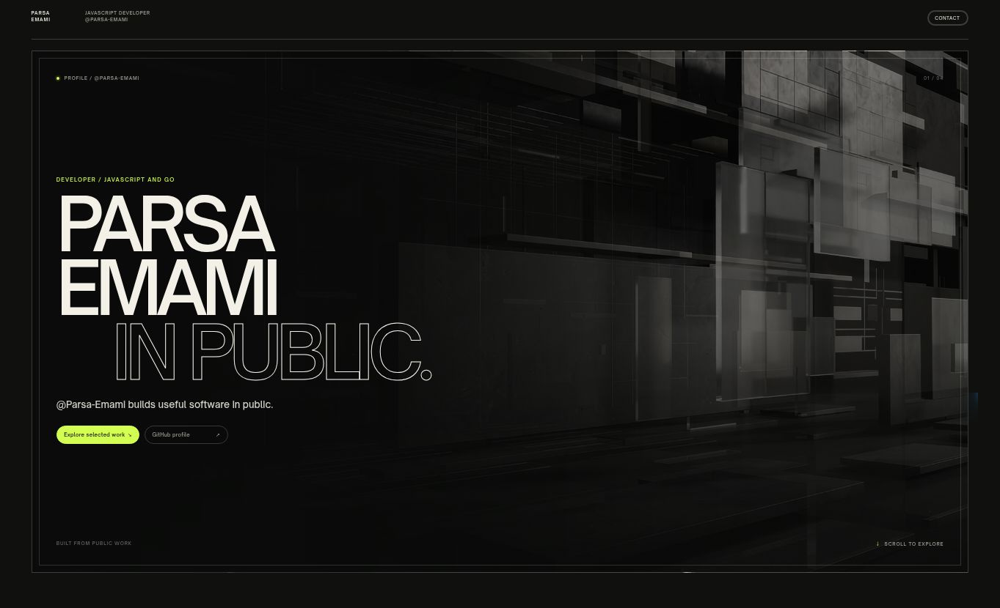
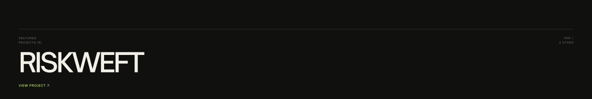
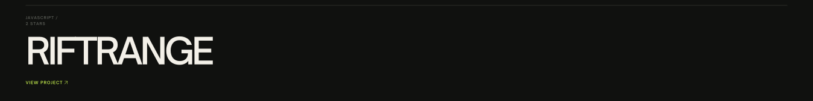
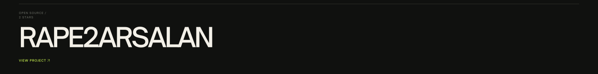
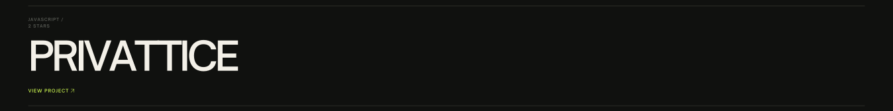
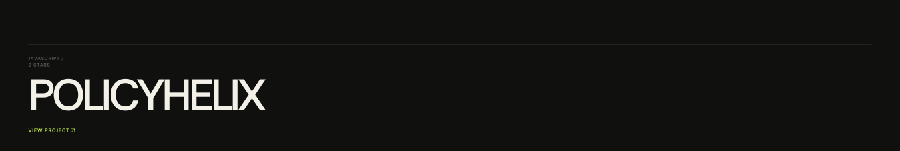
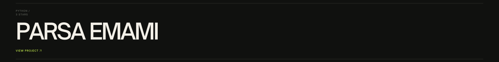
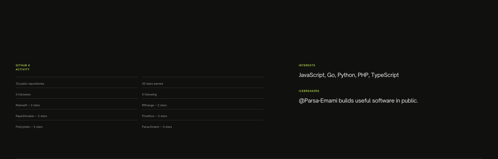
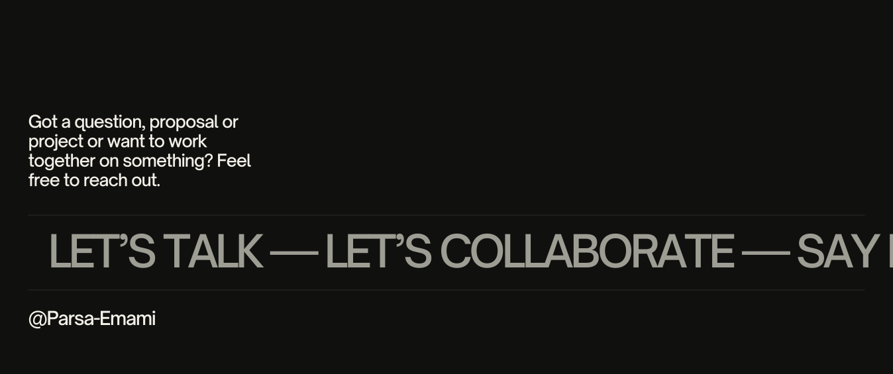
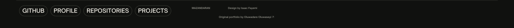

<a href="https://www.gitskins.com/portfolio-templates/seyi-editorial/standalone/?username=Parsa-Emami"><picture><source media="(max-width: 640px)" srcset="assets/seyi-editorial/hero-mobile.svg"></picture></a><a href="https://github.com/Parsa-Emami/Riskweft"><picture><source media="(max-width: 640px)" srcset="assets/seyi-editorial/project-1-mobile.svg"></picture></a><a href="https://github.com/Parsa-Emami/Riftrange"><picture><source media="(max-width: 640px)" srcset="assets/seyi-editorial/project-2-mobile.svg"></picture></a><a href="https://github.com/Parsa-Emami/Rape2Arsalan"><picture><source media="(max-width: 640px)" srcset="assets/seyi-editorial/project-3-mobile.svg"></picture></a><a href="https://github.com/Parsa-Emami/Privattice"><picture><source media="(max-width: 640px)" srcset="assets/seyi-editorial/project-4-mobile.svg"></picture></a><a href="https://github.com/Parsa-Emami?tab=repositories"><picture><source media="(max-width: 640px)" srcset="assets/seyi-editorial/repositories-mobile.svg"></picture></a><a href="https://github.com/Parsa-Emami/Policyhelix"><picture><source media="(max-width: 640px)" srcset="assets/seyi-editorial/project-5-mobile.svg"></picture></a><a href="https://github.com/Parsa-Emami/Parsa-Emami"><picture><source media="(max-width: 640px)" srcset="assets/seyi-editorial/project-6-mobile.svg"></picture></a><a href="https://github.com/Parsa-Emami?tab=repositories"><picture><source media="(max-width: 640px)" srcset="assets/seyi-editorial/activity-mobile.svg"></picture></a><a href="https://github.com/Parsa-Emami"><picture><source media="(max-width: 640px)" srcset="assets/seyi-editorial/contact-mobile.svg"></picture></a><a href="https://github.com/Parsa-Emami?tab=repositories"><picture><source media="(max-width: 640px)" srcset="assets/seyi-editorial/footer-mobile.svg"></picture></a>

Profile, project links & design credits

# Parsa Emami

@Parsa-Emami builds useful software in public.

[Interactive original](https://www.gitskins.com/portfolio-templates/seyi-editorial/standalone/?username=Parsa-Emami) · [GitHub profile](https://github.com/Parsa-Emami) · [All repositories](https://github.com/Parsa-Emami?tab=repositories) · [Email](mailto:parsa.emm@gmail.com)

### Selected work

- [Riskweft](https://github.com/Parsa-Emami/Riskweft) — PHP
- [Riftrange](https://github.com/Parsa-Emami/Riftrange) — JavaScript
- [Rape2Arsalan](https://github.com/Parsa-Emami/Rape2Arsalan) — Open source
- [Privattice](https://github.com/Parsa-Emami/Privattice) — JavaScript
- [Policyhelix](https://github.com/Parsa-Emami/Policyhelix) — JavaScript
- [Parsa-Emami](https://github.com/Parsa-Emami/Parsa-Emami) — Python

### Interests

JavaScript, Go, Python, PHP, TypeScript

### Let’s talk

Got a question, proposal or project or want to work together on something? Feel free to reach out.

This README preserves the appearance and project order of the linked GitSkins reference captured on 2026-10-29. Its displayed repository, star and follower counts reproduce that cached reference; they are not live GitHub totals. The appearance stays dark in both GitHub themes. Project images open their repositories; the hero opens the interactive original. GitHub README images do not run the original video, scrolling, hover, clock or clipboard scripts.

[Design by Isaac Fayemi](https://fayemi.design/) · [Original portfolio by Oluwadare Oluwaseyi](https://github.com/oluwadareseyi/folio-v2) · [GitSkins adaptation](https://www.gitskins.com/portfolio/Parsa-Emami/build?template=seyi-editorial)

Open Sauce typography by Alfredo Marco Pradil / Creative Sauce, SIL Open Font License 1.1. See [source and asset notices](NOTICE.md) and [build instructions](SETUP.md).

